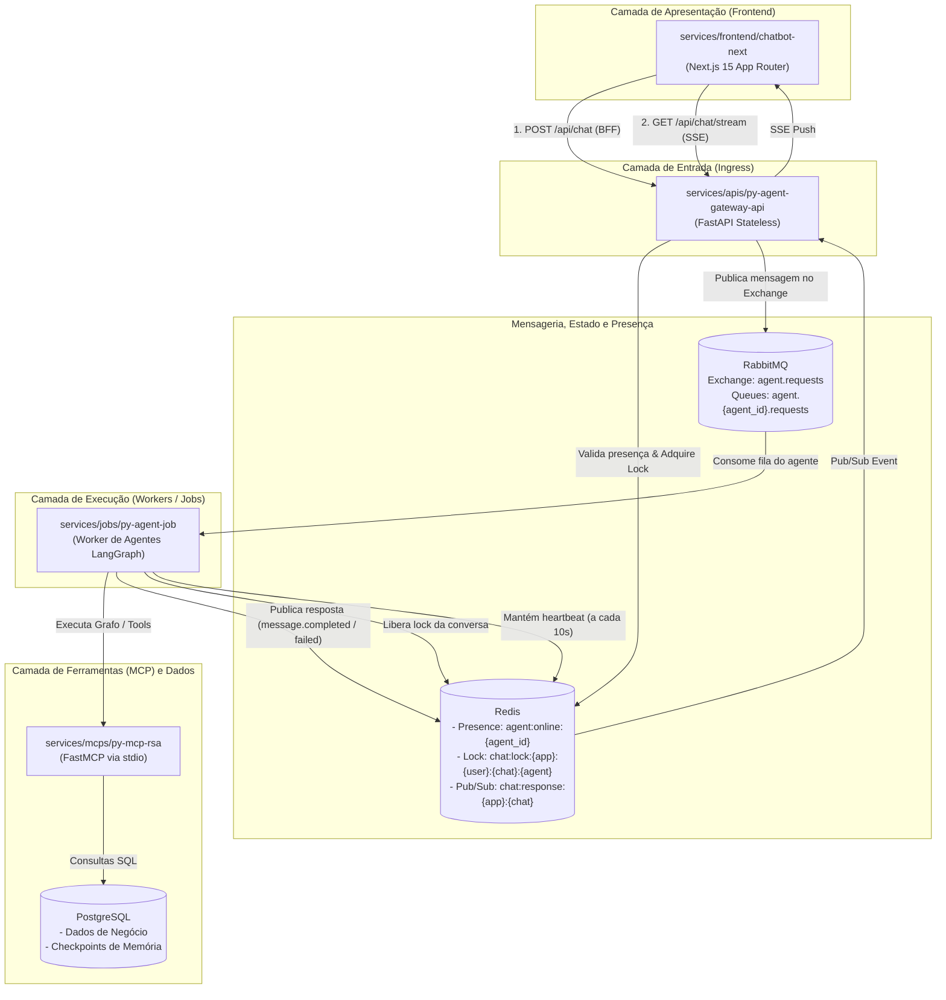

# Arquitetura Global do Sistema (Monorepo Architecture)

Este documento define exclusivamente a **macroarquitetura global** do sistema, a topologia de serviços, os fluxos de comunicação assíncrona entre módulos e os protocolos de mensageria e concorrência do monorepo.

> [!IMPORTANT]
> A **arquitetura de pastas interna**, convenções de camadas e arquivos específicos de cada módulo residem **exclusivamente dentro do `ARCHITECTURE.md` de cada módulo**. Consulte a seção [3. Módulos e Arquiteturas Específicas](#3-módulos-e-arquiteturas-específicas) para acessar a documentação interna de cada serviço.

---

## 1. Visão Geral e Topologia

O sistema é uma plataforma distribuída orientada a eventos para orquestração e execução de agentes de Inteligência Artificial baseados em LangGraph / LangChain, consumindo ferramentas via Model Context Protocol (FastMCP) e entregando respostas em tempo real via Server-Sent Events (SSE).

### 1.1 Diagrama Macroarquitetural

---

## 2. Fluxo Global de Mensagens e Protocolos

### 2.1 Ciclo de Vida da Mensagem no Ecossistema
1. **Ingress (Entrada):** O cliente envia uma mensagem para o Gateway FastAPI (`POST /api/v1/messages`).
2. **Proteções Fail-Fast Globais:**
   - **Presença (`agent:online:{agent_id}` no Redis):** Se o worker do agente não renovou presença nos últimos 30 segundos, a requisição é rejeitada (`503 Service Unavailable`).
   - **Lock de Conversa (`chat:lock:...` no Redis):** Evita processamento concorrente no mesmo chat (`409 Conflict`). Possui TTL de segurança de 120s.
   - **Backpressure de Filas:** O Gateway rejeita mensagens se a fila do agente ultrapassar `QUEUE_MAX_MESSAGES` (`503 Service Unavailable`).
3. **Despacho Assíncrono (`202 Accepted`):**
   - O Gateway publica no exchange RabbitMQ `agent.requests` com routing key `agent.{nome_do_agente}` e responde `202 Accepted` com `message_id`.
4. **Execução pelo Worker:**
   - O worker do agente retira a mensagem da fila `agent.{nome_do_agente}.requests`, deriva o `thread_id` isolado e aciona o grafo LangGraph.
   - Chamadas a ferramentas MCP são executadas em subprocessos locais via protocolo `stdio` (FastMCP).
5. **Publicação da Resposta e Liberação de Lock:**
   - O worker publica `message.completed` ou `message.failed` no canal Redis Pub/Sub `chat:response:{application_id}:{chat_id}`.
   - O worker libera o lock de conversa no Redis e envia `ack` ao RabbitMQ.
6. **Streaming SSE para o Cliente:**
   - A rota de streaming do frontend/gateway consome o canal Redis e envia a resposta para o navegador via Server-Sent Events.

### 2.2 Heartbeat e Descoberta Global
- Cada processo de worker renova a chave `agent:online:{agent_id}` no Redis a cada 10 segundos com TTL de 30 segundos.
- O endpoint `GET /api/v1/agents` lista dinamicamente todos os agentes ativos no ecossistema.

---

## 3. Módulos e Arquiteturas Específicas

A arquitetura interna, organização de pastas e padrões de código de cada componente estão documentados em seus respectivos módulos:

| Categoria | Módulo | Caminho da Arquitetura | Responsabilidade Global |
|---|---|---|---|
| **APIs** | Gateway API | 📄 [services/apis/py-agent-gateway-api/ARCHITECTURE.md](services/apis/py-agent-gateway-api/ARCHITECTURE.md) | Ponto único de entrada HTTP, locks e despacho RabbitMQ |
| **Jobs** | Worker de Agentes | 📄 [services/jobs/py-agent-job/ARCHITECTURE.md](services/jobs/py-agent-job/ARCHITECTURE.md) | Consumo de filas, orquestração LangGraph e publicação Pub/Sub |
| **MCPs** | MCP RSA | 📄 [services/mcps/py-mcp-rsa/ARCHITECTURE.md](services/mcps/py-mcp-rsa/ARCHITECTURE.md) | Servidor FastMCP para catálogo e demandas com sanitização |
| **MCPs** | MCP Select Test | 📄 [services/mcps/py-mcp-select-test/ARCHITECTURE.md](services/mcps/py-mcp-select-test/ARCHITECTURE.md) | Servidor FastMCP de exemplo para consultas SQL diretas |
| **MCPs** | MCP Test | 📄 [services/mcps/py-test-mcp/ARCHITECTURE.md](services/mcps/py-test-mcp/ARCHITECTURE.md) | Servidor FastMCP de demonstração (tools, resources, prompts) |
| **Frontend** | Chatbot Next.js | 📄 [services/frontend/chatbot-next/ARCHITECTURE.md](services/frontend/chatbot-next/ARCHITECTURE.md) | Interface Next.js 15 App Router com BFF e streaming SSE |
| **Packages** | Config | 📄 [packages/config/ARCHITECTURE.md](packages/config/ARCHITECTURE.md) | Pacote reutilizável de logging estruturado |
| **Packages** | Infra | 📄 [packages/infra/ARCHITECTURE.md](packages/infra/ARCHITECTURE.md) | Adaptadores reutilizáveis de PostgreSQL, Redis e MongoDB |

---

## 4. Diretrizes Globais do Monorepo

| Aspecto | Diretriz Global |
|---|---|
| **Localização da Arquitetura de Pastas** | Toda especificação de diretórios e camadas de um módulo deve residir no `ARCHITECTURE.md` daquele módulo, nunca no documento global da raiz. |
| **Papel dos READMEs** | Os arquivos `README.md` contêm apenas uma breve explicação do módulo e comandos operacionais. A arquitetura de pastas e design pertencem a `ARCHITECTURE.md`. |
| **Independência de Serviços** | Os serviços executáveis em `services/*` não devem importar código uns dos outros diretamente. Comunicações entre serviços ocorrem via HTTP, RabbitMQ ou Redis Pub/Sub. |
| **Pacotes Compartilhados** | Módulos em `packages/*` são bibliotecas locais sem processo ou portas de rede. São consumidos como dependências locais (`editable = true`) via gerenciador `uv`. |
| **Orquestração de Infraestrutura** | Arquivos Compose em `composes/` e `docker-compose.yml` orquestram os contêineres locais (Postgres, Redis, RabbitMQ, Langfuse, workers e frontend). |

---

## 5. Checklist de Validação Arquitetural Global

Ao desenvolver ou revisar no monorepo:

- [ ] A modificação respeita a macroarquitetura e os protocolos globais deste documento.
- [ ] A arquitetura de pastas interna do módulo afetado foi verificada e validada em seu próprio `ARCHITECTURE.md`.
- [ ] Caso a estrutura interna de pastas do módulo tenha mudado, o `ARCHITECTURE.md` **daquele módulo** foi atualizado.
- [ ] O `README.md` do módulo mantém apenas breve resumo e comandos, sem duplicar a árvore de pastas.
- [ ] Não foram introduzidas dependências circulares ou acoplamentos diretos entre serviços independentes.
- [ ] Foi criado o registro da tarefa em `.review/` conforme definido em `skills/development.md`.
