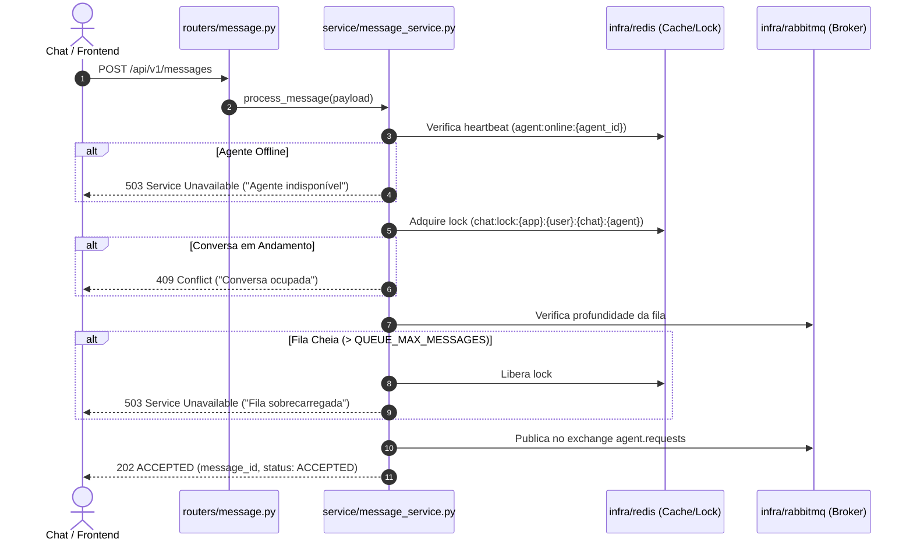

# Arquitetura: py-agent-gateway-api

## 1. Responsabilidade do Módulo

O `py-agent-gateway-api` é um gateway HTTP stateless construído com FastAPI. Sua responsabilidade é servir como o único ponto de entrada para clientes e frontends, aplicando validações síncronas rápidas (fail-fast), garantindo isolamento de concorrência por conversa e despachando mensagens de forma confiável para filas RabbitMQ dedicadas a cada agente.

---

## 2. Estrutura de Pastas e Componentes

```text
services/apis/py-agent-gateway-api/
├── src/
│   ├── main.py               # Configuração do FastAPI, lifespan de recursos e inclusão de rotas
│   ├── dependencies.py       # Injeção de dependências e gerenciamento do ciclo de vida por requisição
│   ├── routers/              # Handlers HTTP organizados por recurso
│   │   ├── agents.py         # GET /api/v1/agents (descoberta dinâmica de agentes)
│   │   └── message.py        # POST /api/v1/messages (ingestão assíncrona)
│   ├── schemas/              # Contratos Pydantic de entrada e saída (DTOs)
│   │   └── message.py        # MessagePayload, MessageAcceptedResponse, AgentSummary
│   ├── service/              # Lógica de aplicação, orquestração e regras de proteção
│   │   ├── conversation_lock.py   # Lock distribuído no Redis (SET NX PX)
│   │   ├── delivery_service.py    # Abstração de canais de entrega
│   │   ├── message_service.py     # Validação de presença, lock e despacho
│   │   ├── orchestrator_service.py# Orquestração do ciclo de vida da mensagem
│   │   └── queue_threshold.py     # Checagem de backpressure da fila RabbitMQ
│   └── infra/                # Clientes e adaptadores externos (I/O)
│       ├── rabbitmq/         # Producer, consumer e conexão com broker RabbitMQ
│       ├── redis/            # Repositório de presença (agent:online) e locks
│       └── postgresql/       # Utilitários de conexão relacional
├── tests/                    # Suíte de testes unitários e de integração com pytest
├── pyproject.toml            # Dependências e ferramentas (uv, pytest, ruff)
└── README.md                 # Guia de inicialização e documentação operacional
```

---

## 3. Fluxo de Execução da Mensagem



---

## 4. Regras Arquiteturais para Modificação

Ao modificar ou adicionar código neste serviço:
1. **Roteamento Puro:** Os arquivos em `src/routers/` não devem implementar lógica de negócio ou queries diretas a bancos/brokers. Eles recebem o DTO do `schemas/`, chamam um serviço injetado via `dependencies.py` e retornam a resposta.
2. **Ciclo de Vida de Conexões:** Clientes RabbitMQ e Redis devem ser instanciados ou obtidos via injeção de dependência em `dependencies.py` para evitar conexões presas ou deadlocks.
3. **Stateless:** O gateway não mantém estado em memória local. Todo estado compartilhado reside no Redis.
4. **Testes Obrigatórios:** Toda nova rota ou regra em `service/` deve possuir testes correspondentes em `tests/`.
