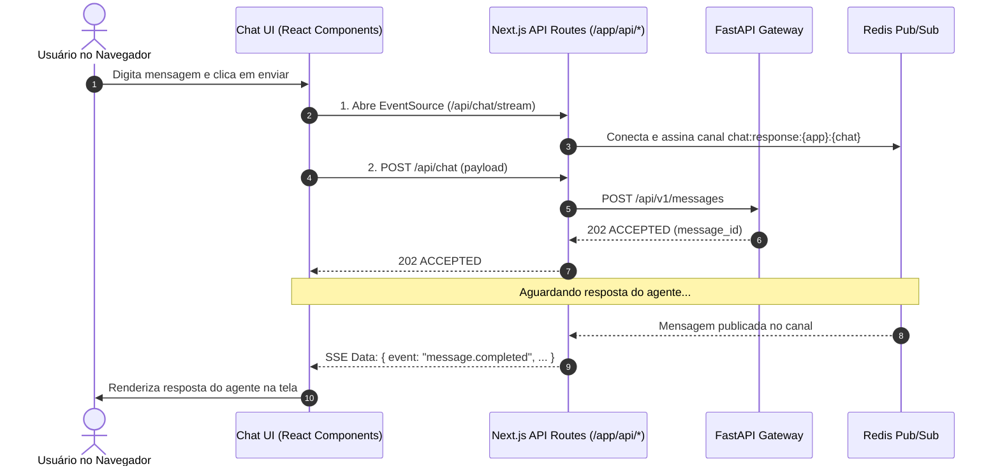

# Arquitetura: chatbot-next

## 1. Responsabilidade do Módulo

O `chatbot-next` é a aplicação frontend e interface de usuário construída sobre Next.js 15 (App Router). Ele fornece uma experiência interativa em tempo real para seleção de agentes ativos, envio de prompts e recepção de respostas por Server-Sent Events (SSE), atuando também como camada Backend-For-Frontend (BFF) para isolamento seguro de infraestrutura interna.

---

## 2. Estrutura de Pastas e Componentes

```text
services/frontend/chatbot-next/
├── app/                      # Next.js 15 App Router
│   ├── api/                  # Backend-For-Frontend (BFF Routes)
│   │   ├── agents/route.ts   # Proxy para descoberta de agentes ativos
│   │   ├── chat/route.ts     # Proxy para disparo de mensagens ao Gateway
│   │   └── chat/stream/route.ts # Proxy para streaming SSE conectado ao Redis Pub/Sub
│   ├── layout.tsx            # Root layout e provedores de estado/tema
│   └── page.tsx              # Página principal do chat
├── components/               # Componentes visuais modulares (React / Radix UI / Tailwind)
├── hooks/                    # Hooks customizados para regras de UI e SSE (ex: useChat, useSSE)
├── lib/                      # Utilitários, constantes e chat-server.ts
├── types/                    # Definições de tipos TypeScript compartilhadas
├── package.json
└── README.md
```

---

## 3. Fluxo de Interação do Frontend



---

## 4. Diretrizes de Desenvolvimento

1. **Camada BFF Obrigatória:** O navegador do usuário nunca deve se comunicar diretamente com o Redis ou expor URLs internas de contêineres Docker. Toda comunicação é encapsulada pelas rotas em `/app/api/`.
2. **Componentização:** Componentes de interface devem permanecer modulares dentro de `components/`, desacoplados de regras globais de streaming.
3. **Gerenciamento de Estado:** O estado de conversas ativas é mantido de forma reativa na aplicação cliente e via `thread_id` na camada de agentes.
