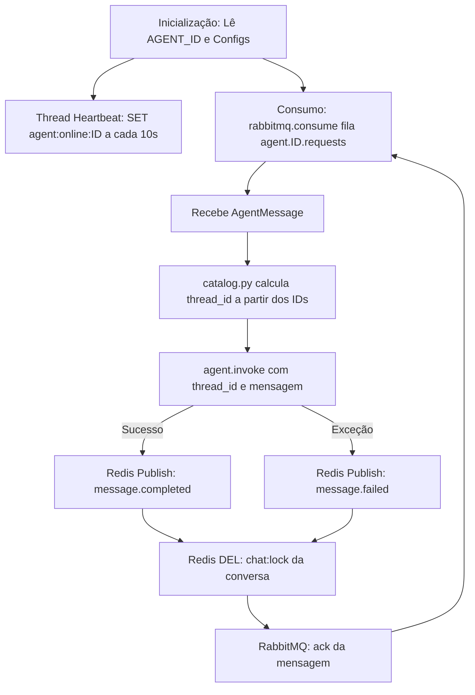

# Arquitetura: py-agent-job

## 1. Responsabilidade do Módulo

O `py-agent-job` é o executor unificado de agentes inteligentes (Workers) baseado em LangGraph e LangChain. Ele consome requisições de agentes em filas RabbitMQ, orquestra grafos de decisão com ferramentas (via FastMCP e conexões a bancos), gerencia a persistência de checkpoints e publica as respostas ou erros no Redis Pub/Sub, garantindo liberação de locks de concorrência e sinalização de heartbeat contínuo.

---

## 2. Estrutura de Pastas e Padrão de Agentes

```text
services/jobs/py-agent-job/
├── src/
│   ├── main.py               # Loop de consumo RabbitMQ, ack, liberação de locks e thread de heartbeat
│   ├── entity/               # Value Objects e modelos de domínio interno
│   │   └── message.py        # AgentMessage (payload padronizado)
│   ├── agents/               # Catálogo e implementações dos agentes
│   │   ├── catalog.py        # Mapeamento dinâmico de AGENT_ID para grafos compilados
│   │   └── langchain_agents/ # Módulos individuais de cada agente
│   │       ├── agent_runtime.py   # Instrumentação e callbacks (ex: Langfuse)
│   │       └── <nome_do_agente>/  # ESTRUTURA OBRIGATÓRIA DE CADA AGENTE:
│   │           ├── __init__.py          # Docstring com propósito do agente
│   │           ├── model.py             # Instanciação do ChatOpenAI / LLM com @lru_cache
│   │           ├── prompts/
│   │           │   ├── __init__.py      # Exporta SYSTEM_PROMPT
│   │           │   └── system_prompt.py # Texto do prompt de sistema
│   │           ├── graph/
│   │           │   ├── __init__.py      # Exporta a variável `graph`
│   │           │   ├── state.py         # AgentState (TypedDict com message, response, thread_id)
│   │           │   ├── nodes.py         # Nós do grafo LangGraph (ex: receive_message, call_tools)
│   │           │   ├── memory.py        # (Opcional) Checkpointer e retenção de histórico
│   │           │   └── graph.py         # Montagem do StateGraph e compilação (.compile())
│   │           └── tools/               # (Opcional) Tools locais ou clientes de conexão MCP
│   └── infra/                # Clientes externos do worker
│       ├── rabbitmq/         # Consumo assíncrono com retentativas e ack
│       ├── redis/            # Publicação no Pub/Sub, liberação de lock e heartbeat
│       ├── postgresql/       # Checkpointers PostgreSQL (LangGraph persistence)
│       └── sql_database/     # Conexões SQL dedicadas
├── evals/                    # Avaliações semânticas de qualidade dos agentes
├── tests/                    # Testes automatizados do worker e grafos
├── pyproject.toml            # Dependências e pythonpath configurado
└── README.md                 # Guia do worker e dos agentes
```

---

## 3. Fluxo de Vida do Worker



---

## 4. Regras Obrigatórias para Criação e Alteração de Agentes

1. **Localização e Nomenclatura:** Todo novo agente deve residir em `src/agents/langchain_agents/<nome_do_agente>/` com nome em `snake_case`.
2. **Separação de Camadas do Agente:**
   - LLMs residem exclusivamente em `model.py` com `@lru_cache`.
   - Prompts residem exclusivamente em `prompts/`.
   - Nós de processamento residem em `graph/nodes.py`.
   - Definição de estado reside em `graph/state.py`.
   - O grafo compilado reside em `graph/graph.py` e é exportado por `graph/__init__.py`.
3. **Registro no Catálogo:** Todo agente deve ser registrado em [`src/agents/catalog.py`](file:///C:/Users/ax12813/orca/workspaces/agent_module_with_redis/waspfish/services/jobs/py-agent-job/src/agents/catalog.py) apontando para o módulo do grafo compilado (`agents.langchain_agents.<nome>.graph.graph`).
4. **Contrato de Saída:** O agente deve preencher o campo `response` no seu estado com texto válido e não-vazio.
5. **Tratamento de Falhas:** O worker nunca deve deixar uma mensagem sem ack após publicação nem travar o lock do usuário.
