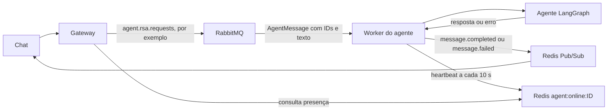

# Worker unificado de agentes

Cada processo usa `AGENT_ID` para escolher sua fila RabbitMQ e seu agente. `rabbitmq.consume(queue)` entrega uma sequência de `AgentMessage`; para cada mensagem, o worker chama `agent.invoke(message)`, publica a resposta no Redis e confirma a entrega no RabbitMQ. Uma thread renova a presença do agente no Redis.

```python
for message in rabbitmq.consume(queue):
    response = agent.invoke(message)
    publisher.publish(message, response)
    rabbitmq.ack()
```

O `main.py` também publica `message.failed` quando o agente gera erro e libera o bloqueio da conversa criado pelo gateway. Todos os arquivos `__init__.py` do worker estão vazios; o catálogo de agentes e a identidade das conversas ficam em `src/agents/catalog.py`.



Se o agente falhar, o worker registra a exceção e publica `message.failed` com os mesmos IDs. O gateway bloqueia a conversa enquanto ela é processada; o worker libera esse bloqueio após publicar a resposta, permitindo a próxima mensagem.

## Estrutura

- `src/main.py` escolhe a fila, percorre `rabbitmq.consume(queue)`, chama o agente, publica o resultado, confirma a mensagem e mantém o heartbeat e a reconexão.
- `src/entity/message.py` define `AgentMessage` com os IDs, o texto e os campos opcionais da conversa.
- `src/agents/catalog.py` escolhe o grafo por ID, calcula a identidade da conversa e entrega ao `main.py` um agente com `invoke(message)`. Ele também mantém o loop assíncrono e o checkpoint RSA abertos.
- `src/agents/langchain_agents/simple_agent/` repete a entrada.
- `src/agents/langchain_agents/rsa_agent.py` contém estado, modelo, MCP, nó de conversa, nó de resumo e grafo do RSA. O agente usa `list_services_with_done_examples` para listar serviços ativos ou recomendar um serviço para uma necessidade, mostrando o caminho no menu quando disponível e sem expor IDs. Pedidos gerais de listagem chamam a tool diretamente e mostram todos os nomes agrupados pelo caminho do menu; o catálogo injeta o checkpointer PostgreSQL.
- `src/agents/langchain_agents/argus_agent/` consulta PostgreSQL em modo somente leitura e mantém memória limitada por conversa.
- `src/infra/rabbitmq/connection.py` recebe a fila e devolve `AgentMessage`; `ack()` confirma a entrega após o Pub/Sub. `src/infra/redis/` publica a resposta e renova `agent:online:{agent_id}` a cada 10 segundos, com validade de 30 segundos.

## Configuração no Compose

O mesmo Dockerfile atende os serviços `agent-simple`, `agent-rsa` e `agent-argus` em `composes/compose.services.yaml`. `.env.simple`, `.env.rsa` e `.env.argus` definem `AGENT_ID` e, quando necessário, a configuração própria do agente. O Compose fornece apenas as conexões básicas do RabbitMQ e do Redis aos workers. A fila é calculada como `agent.{nome}.requests`: `rsa-agent` usa `agent.rsa.requests`, `simple-agent` usa `agent.simple.requests` e `argus-agent` usa `agent.argus.requests`. O exchange é `agent.requests`. O RSA recebe as variáveis do banco de `services/mcps/py-mcp-rsa/.env`; o Argus lê o modelo e o banco de `.env.argus`. O host PostgreSQL do RSA é sobrescrito para `host.docker.internal` porque o banco da configuração está no host.

Variáveis comuns usadas pelo worker: `AGENT_ID`, `RABBITMQ_HOST/USER/PASSWORD`, `REDIS_HOST` e, se necessário, `RABBITMQ_PORT`, `REDIS_PORT` e `REDIS_PASSWORD`. O RabbitMQ usa três tentativas por conexão, com intervalo de um segundo; quando o consumo cai, o worker tenta reconectar após três segundos. O Redis usa o banco 0 e o canal `chat:response`. Um agente novo requer um grafo no catálogo e um serviço Compose com seu ID. As variáveis de modelo, MCP, banco e memória continuam próprias de cada agente.

## Rastreamento com Langfuse

Os três agentes do worker (`agent-simple`, `agent-rsa` e `agent-argus`) criam `CallbackHandler` diretamente em `src/agents/langchain_agents/agent_runtime.py` e o passam ao grafo pelo `config`. O `conversation_id` recebido do gateway é usado sem alteração tanto em `configurable.thread_id` quanto em `metadata.langfuse_session_id`, junto com a tag do agente. Se a mensagem não trouxer um ID de conversa, o agente gera um para aquela execução. Sem chaves de API, o cliente Langfuse não envia rastreamentos.

Para usar a stack local existente em `composes/compose-langfuse/compose.langfuse.yaml`, copie `composes/compose-langfuse/.env.example` para `.env` na mesma pasta e substitua todos os valores `CHANGE_ME`. Mantenha `DATABASE_URL` consistente com `POSTGRES_PASSWORD` e as três chaves S3 consistentes com `MINIO_ROOT_PASSWORD`. A URL pública do Langfuse é `http://localhost:3002`. Crie um projeto na interface ou configure as variáveis `LANGFUSE_INIT_*` no arquivo `.env` para criar o projeto e as chaves na inicialização.

~~~powershell
docker-compose --env-file composes/compose-langfuse/.env -f composes/compose-langfuse/compose.langfuse.yaml up -d
~~~

Em `composes/compose-langfuse/.env.agent`, configure as chaves abaixo. Esse arquivo é ignorado pelo Git e carregado pelos três workers no Docker Compose. Para Langfuse Cloud, substitua `LANGFUSE_BASE_URL` no Compose pela URL da região do seu projeto. `host.docker.internal` permite que os workers Docker alcancem a stack local pela porta publicada no host.

~~~dotenv
LANGFUSE_PUBLIC_KEY=pk-lf-...
LANGFUSE_SECRET_KEY=sk-lf-...
~~~

Depois, recrie os workers com `docker-compose up -d --build --force-recreate agent-simple agent-rsa agent-argus`. Envie uma mensagem no chat e confira a execução em Tracing no projeto Langfuse. O conteúdo das mensagens e das respostas das ferramentas passa a constar nos rastreamentos; configure a retenção e o acesso ao projeto conforme seus dados.

## Desenvolvimento

Python 3.11 ou superior; o Dockerfile usa Python 3.12.

~~~powershell
cd services/jobs/py-agent-job
uv sync --frozen
uv run pytest tests
uv run ruff check src tests
~~~

As avaliações com perguntas e respostas de referência ficam em [evals/](evals/README.md), separadas dos testes rápidos. Há um conjunto de casos para cada agente; os casos semânticos usam um modelo como juiz.

O agente Argus usa o `SQLDatabaseToolkit` do serviço SQL original e herda sua conexão PostgreSQL com transações somente de leitura. O RSA usa `RSA_MEMORY_MAX_MESSAGES` (20 no `.env.rsa`) como limite para gerar um resumo das mensagens antigas; após resumir, mantém a última troca em `messages` e o resumo no estado. O RSA lê modelo, caminho do MCP e memória do ambiente do worker; o MCP lê suas próprias variáveis de banco no `.env` dele. Uma variável exigida ausente no RSA gera o erro original de configuração. Seu `AsyncShallowPostgresSaver` usa `RSA_CHECKPOINT_DATABASE_URL` e mantém apenas o checkpoint mais recente por conversa no PostgreSQL `postgres-vector`; a memória curta sobrevive ao reinício do worker. A memória do Argus continua no processo. A entrega Redis Pub/Sub não oferece replay.

`AsyncShallowPostgresSaver` está depreciado, mas permanece fixado na versão atual porque mantém exatamente um checkpoint por conversa. `AsyncPostgresSaver` com `durability="exit"` ainda acumula um checkpoint a cada execução. O Argus também depende de `langchain-community`, pacote em descontinuação; migrar seu toolkit SQL requer uma mudança separada.
